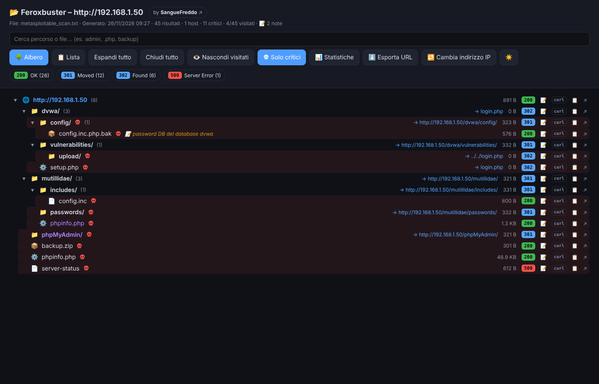
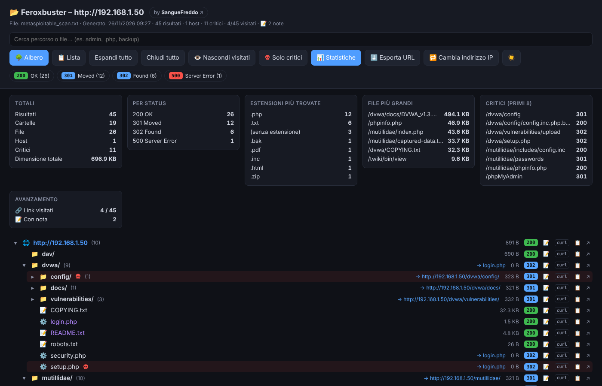
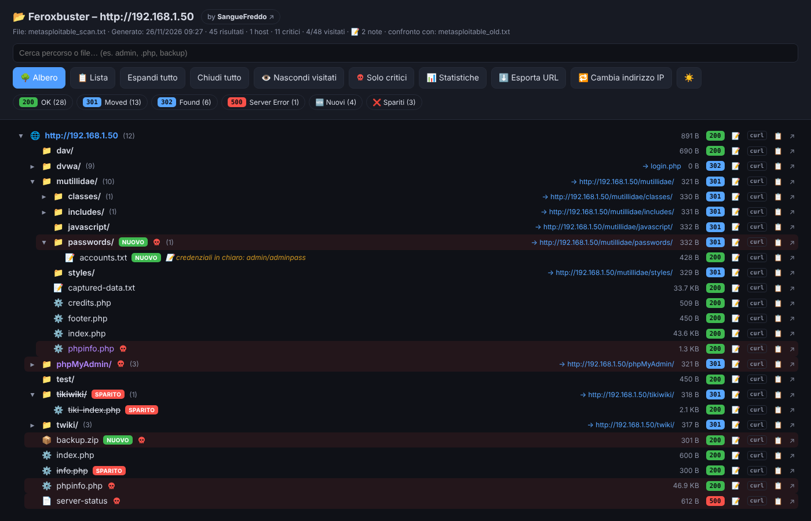
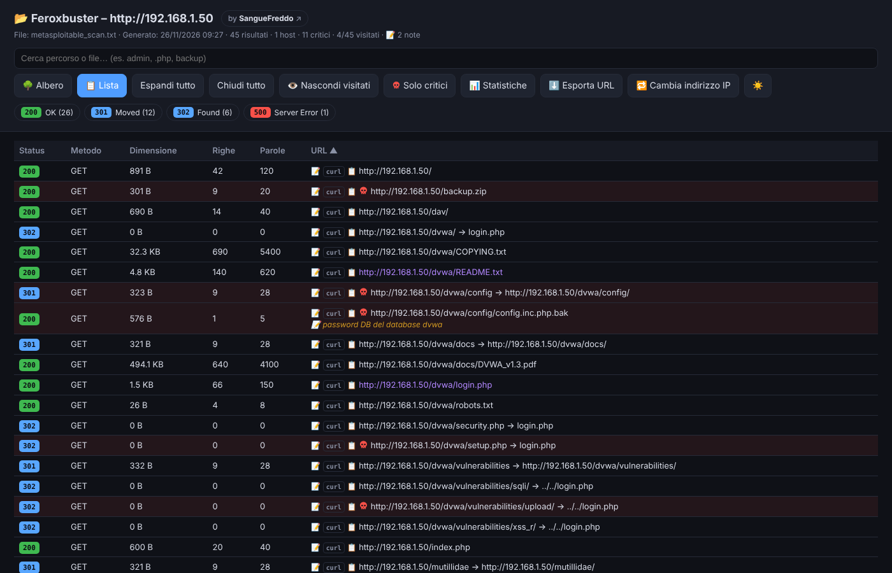
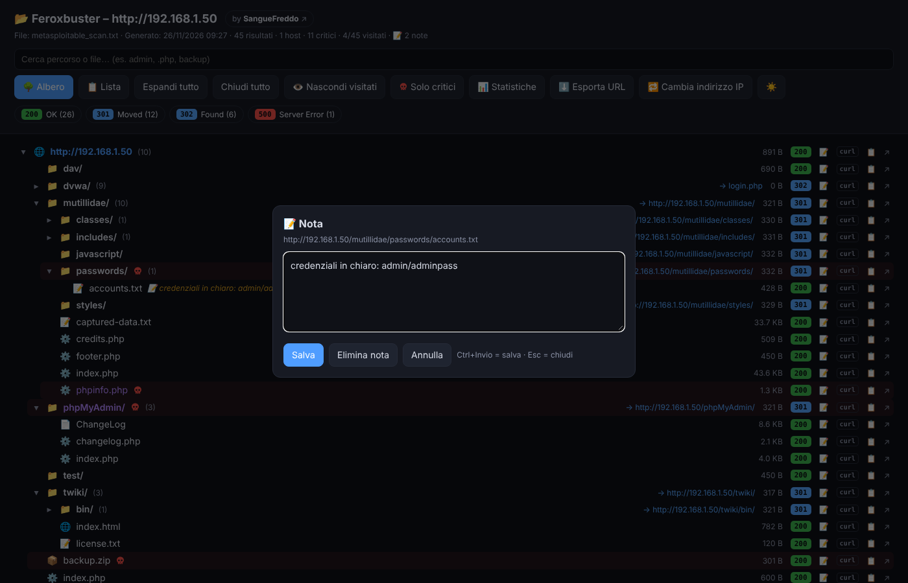
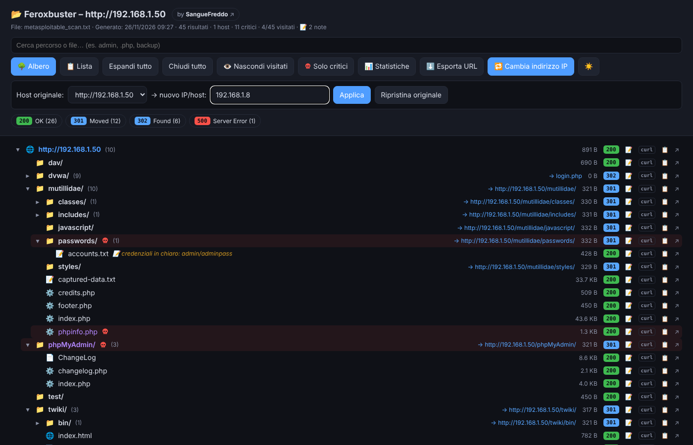
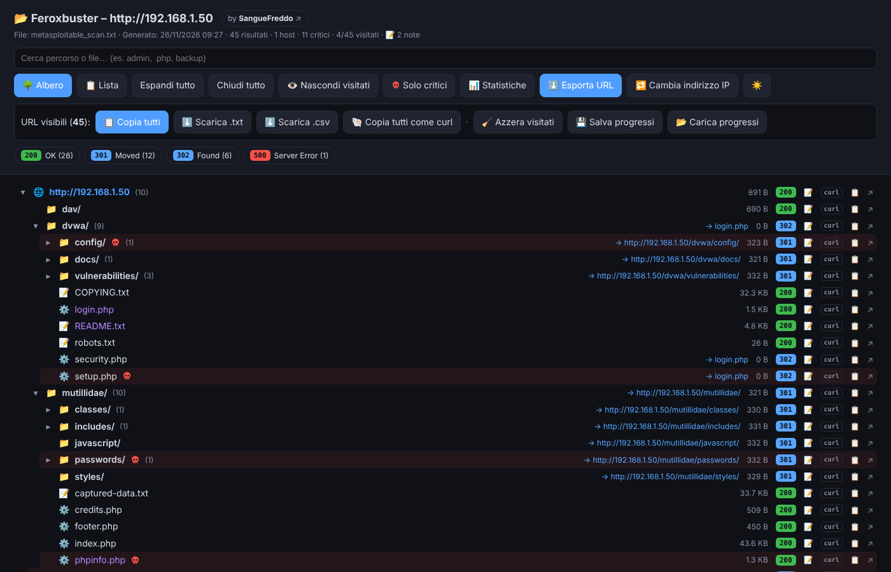
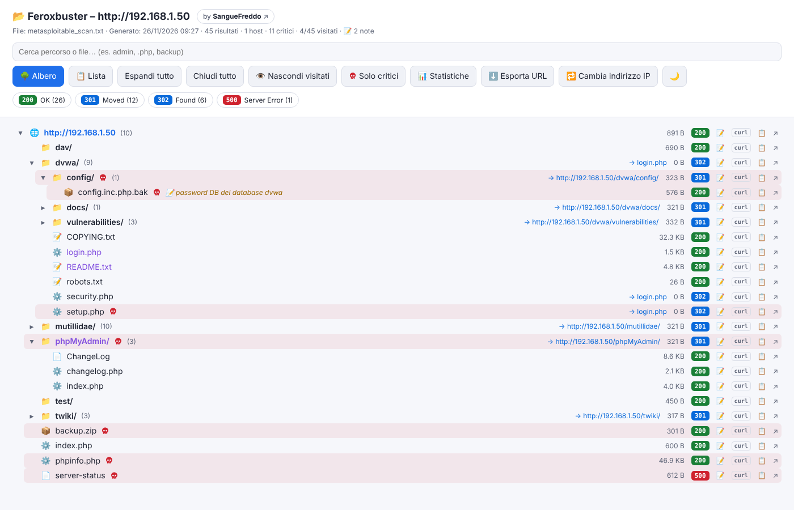
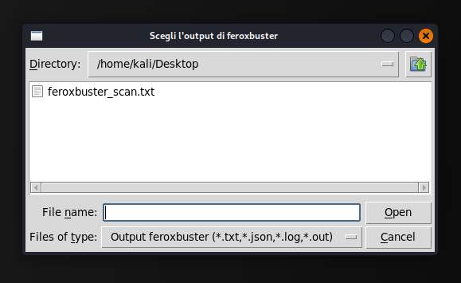

<div align="center">


# 🌳 Ferox2html — FeroxbusterTree

**Turn your feroxbuster scan into a clean, clickable DirBuster-style tree.**


%20%7C%20Windows-lightgrey)


[English](#-what-it-does) · [Italiano](#-italiano)


</div>

---

## ✨ What it does

[feroxbuster](https://github.com/epi052/feroxbuster) is fast, but its output is a long flat list of URLs.
**Ferox2html** reads the output file and builds a single, self-contained HTML page where you can browse every folder and file the scan found, just like the old DirBuster tree.

- 🌳 **Tree view**: folders and files grouped by host, expand/collapse with one click
- 📋 **List view**: a sortable table (status, size, lines, words, URL)
- 🎨 **Coloured status codes**: 2xx green · 3xx blue · 4xx orange · 5xx red
- 🔀 **Redirects**: see where each 301/302 points
- 🔍 **Instant search**: type `admin`, `.php`, `backup`…
- 🎛️ **Status filters**: click a badge to hide or show 403s, 301s and so on
- 🔗 **Clickable names**: click any file or folder to open it in a new tab
- 📋 **Copy URL** in one click, ↗ **open** button too
- 🔁 **Change IP address**: the target got a new IP? Update every link in the page in one go, no rescan needed
- 💀 **Critical files flagged with a red skull**: backups, dumps, configs, `.env`, `.git`, credentials, admin panels… with a one-click *only critical* filter
- ⬇️ **Export URLs**: copy all visible URLs, or download them as `.txt` / `.csv`, ready for curl, nuclei or Burp
- 📊 **Statistics**: totals, status codes, top extensions, biggest files, critical findings
- 🟣 **Visited links turn purple**, like on Google: you always know what you've already opened, and can hide it with one click
- 📝 **Notes** on any file or folder (e.g. *creds in cleartext*); notes are searchable and exported to CSV
- 🆚 **Compare two scans**: `--compare old.txt` marks what's **NEW** and what **DISAPPEARED** (works even if the target changed IP)
- 🐚 **Copy as curl**: one click gives you `curl -i -s -k -X GET '<url>'`, or copy them all at once
- 💾 **Save / load progress**: export visited links, notes and IP change to a `.json` file and reload it on any browser
- 🧬 **Merge scans**: combine several feroxbuster files into one report, duplicates removed
- 🌙 **Dark theme by default**, ☀️ light theme in one click (remembered), clean printing to PDF
- 🧩 **File-type icons**: scripts, backups, configs, images…
- 📦 **Zero dependencies**: plain Python 3, and the report is one offline HTML file
- 🛡️ **Safe rendering**: names coming from the target are shown as plain text, never executed

## 📸 Screenshots

> Taken against **Metasploitable 2**, a deliberately vulnerable lab VM.

### 🌳 Tree view
Visited links in purple, critical files with the red skull, notes next to the files.


| 💀 Only critical files | 📊 Statistics |
|:---:|:---:|
|  |  |
| **🆚 Compare two scans** (NEW / DISAPPEARED) | **📋 List view** |
|  |  |
| **📝 Notes** | **🔁 Change IP address** |
|  |  |
| **⬇️ Export URLs / curl / progress** | **☀️ Light theme** |
|  |  |

**🖱️ Double-click the icon and pick the file:**



## 📥 Installation

### 🐧 Linux (Kali, Parrot, Debian, Ubuntu): recommended

**1. Download the project**

```bash
git clone https://github.com/SangueFreddo/Ferox2html---FeroxbusterTree.git
cd Ferox2html---FeroxbusterTree
```

No git? On GitHub click **Code → Download ZIP**, extract it and open a terminal inside the folder.

**2. Run the installer** (no sudo needed, everything stays in your user)

```bash
chmod +x install.sh
./install.sh
```

**3. Done.** You now have:

| What | How to use it |
|---|---|
| 🖱️ **Ferox2html icon** in the applications menu and on the Desktop | double-click it → pick your scan file → the report opens in the browser |
| 📂 **Open with** on scan files | right-click `feroxbuster_scan.txt` → **Open with → Ferox2html** |
| ⌨️ **`ferox2html` command** in the terminal | `ferox2html ~/Desktop/feroxbuster_scan.txt` |

**If something doesn't work**

- The Desktop icon asks *"Untrusted application launcher"* → click **Launch Anyway** / **Mark Executable** (only the first time).
- The file picker doesn't open → `sudo apt install python3-tk`
- `ferox2html: command not found` → add `export PATH="$HOME/.local/bin:$PATH"` to `~/.zshrc` and open a new terminal (the installer tells you if it's needed).
- You moved the project folder → run `./install.sh` again.

**Uninstall:** `./install.sh --uninstall` (your scans and reports are not touched).

### 🪟 Windows

1. Install [Python](https://www.python.org/downloads/) and during setup tick **Add python.exe to PATH**.
2. Download the project (**Code → Download ZIP**) and extract it.
3. Open the `windows` folder and double-click **`install_windows.bat`**.
4. A **Ferox2html** icon appears on the Desktop: double-click it to pick a file, or **drag your scan files onto it**.

If Windows shows *"Windows protected your PC"*, click **More info → Run anyway** (it's a plain script, you can open it with Notepad to check).
To remove it, just delete the icon from the Desktop.

> Double-clicking `ferox2html.py` itself opens your code editor (that's how the OS handles `.py` files): use the icon instead.

## 🚀 Quick start

**1. Run feroxbuster and save the output**

Recommended scan (used for the screenshots):

```bash
feroxbuster --url http://<TARGET_IP> \
  -w /usr/share/wordlists/dirbuster/directory-list-2.3-medium.txt \
  -x php,txt,html -d 3 -t 50 \
  --filter-status 404,403 \
  -o ~/Desktop/feroxbuster_scan.txt
```

| Option | Meaning |
|---|---|
| `-w` | wordlist (DirBuster medium, preinstalled on Kali) |
| `-x php,txt,html` | also try these extensions |
| `-d 3` | recursion depth: up to 3 folders deep |
| `-t 50` | 50 threads |
| `--filter-status 404,403` | hide "not found" and "forbidden" results |
| `-o` | save the results to a file |

Minimal version, and JSON output (also supported):

```bash
feroxbuster -u http://<TARGET_IP> -o scan.txt
feroxbuster -u http://<TARGET_IP> --json -o scan.json
```

**2. Convert it**

```bash
python3 ferox2html.py ~/Desktop/feroxbuster_scan.txt
# or, after ./install.sh
ferox2html ~/Desktop/feroxbuster_scan.txt
```

…or just double-click the **Ferox2html** icon and choose the file.
`feroxbuster_scan.html` is created next to your scan and opens in your browser.

### Other ways to run it

| How | Command |
|---|---|
| Choose the output name | `python3 ferox2html.py scan.txt -o report.html` |
| Don't open the browser | `python3 ferox2html.py scan.txt --no-open` |
| Compare with an older scan | `python3 ferox2html.py new.txt --compare old.txt` → `new_diff.html` |
| Merge several scans | `python3 ferox2html.py scan1.txt scan2.json` → `scan1_merged.html` |
| Pick the file(s) from a window | `python3 ferox2html.py` (no arguments, multiple selection allowed) |
| Drag & drop (Windows) | drag scan files onto the **Ferox2html** icon |

Try it right away with the included Metasploitable 2 examples:

```bash
python3 ferox2html.py example/metasploitable_scan.txt
python3 ferox2html.py example/metasploitable_scan.txt --compare example/metasploitable_old.txt
```

## 🖱️ Using the report

| Action | How |
|---|---|
| Open a file or folder | click its name |
| Expand / collapse a folder | click the ▸ arrow or the 📁 icon |
| Expand / collapse everything | **Espandi tutto** / **Chiudi tutto** |
| Copy a URL | 📋 button |
| Open a URL | ↗ button |
| Filter by status | click the status badges at the top |
| Search | type in the search bar |
| Sort the table | **Lista** view, click a column header |
| Visited links | open a link and it turns **purple**; **👁️ Nascondi visitati** hides them, **🧹 Azzera visitati** (in Esporta URL) resets them |
| Add a note | 📝 button (Ctrl+Enter saves, Esc closes); click a note to edit it |
| Copy as curl | `curl` button on the row, or **⬇️ Esporta URL → Copia tutti come curl** |
| New / disappeared (compare) | **🆕 Nuovi** / **❌ Spariti** chips at the top |
| Save your work | **⬇️ Esporta URL → 💾 Salva progressi**, then **📂 Carica progressi** on any browser |
| Show only critical files | **💀 Solo critici** |
| See statistics | **📊 Statistiche** |
| Export URLs | **⬇️ Esporta URL** → copy all, `.txt` or `.csv` (only what is visible with current filters) |
| Switch theme | ☀️ / 🌙 button (dark is the default) |
| Save as PDF | browser print (Ctrl+P): folders are expanded and buttons hidden automatically |
| Target changed IP | **🔁 Cambia indirizzo IP**, type the new IP (e.g. `192.168.1.8` or `192.168.1.8:8080`) and press Enter. **Ripristina originale** undoes it. The choice is remembered when you reopen the page |

## 📄 Supported input

| feroxbuster option | Format | Supported |
|---|---|:---:|
| `-o file` | plain text | ✅ |
| `--json -o file` | JSON lines | ✅ |
| Lines with redirects (`=>`) | text | ✅ |
| Colour codes (ANSI) | text | ✅ stripped automatically |
| Multiple hosts in one file | both | ✅ one tree per host |

Lines that are not results (wildcard notices, errors, statistics) are skipped.

## ⚙️ Requirements

- Python **3.7+**
- Nothing else: only the standard library is used

## ⚠️ Disclaimer

This tool only reads files you already have; it sends no traffic.
Run feroxbuster **only against systems you own or are explicitly authorised to test**.

## 📜 License

[MIT](LICENSE) © [SangueFreddo](https://github.com/SangueFreddo)

---

## 🇮🇹 Italiano

**Ferox2html** trasforma l'output di feroxbuster in una pagina HTML con l'albero di cartelle e file, come DirBuster.

### 📥 Installazione su Linux (Kali, Parrot, Debian, Ubuntu): consigliata

**1. Scarica il progetto**

```bash
git clone https://github.com/SangueFreddo/Ferox2html---FeroxbusterTree.git
cd Ferox2html---FeroxbusterTree
```

Senza git: su GitHub clicca **Code → Download ZIP**, estrai la cartella e apri un terminale al suo interno.

**2. Avvia l'installer** (non serve sudo, installa tutto solo per il tuo utente)

```bash
chmod +x install.sh
./install.sh
```

**3. Fatto.** Adesso hai:

| Cosa | Come si usa |
|---|---|
| 🖱️ **Icona Ferox2html** nel menu applicazioni e sul Desktop | doppio clic → scegli il file della scansione → il report si apre nel browser |
| 📂 **Apri con** sui file delle scansioni | tasto destro su `feroxbuster_scan.txt` → **Apri con → Ferox2html** |
| ⌨️ **Comando `ferox2html`** nel terminale | `ferox2html ~/Desktop/feroxbuster_scan.txt` |

**Se qualcosa non va**

- L'icona sul Desktop chiede *"Untrusted application launcher"* → clicca **Launch Anyway** / **Mark Executable** (solo la prima volta).
- Non si apre la finestra per scegliere il file → `sudo apt install python3-tk`
- `ferox2html: command not found` → aggiungi `export PATH="$HOME/.local/bin:$PATH"` in `~/.zshrc` e apri un nuovo terminale (l'installer ti avvisa se serve).
- Hai spostato la cartella del progetto → rilancia `./install.sh`.

**Disinstallare:** `./install.sh --uninstall` (le tue scansioni e i report non vengono toccati).

### 🪟 Installazione su Windows

1. Installa [Python](https://www.python.org/downloads/) e durante l'installazione spunta **Add python.exe to PATH**.
2. Scarica il progetto (**Code → Download ZIP**) ed estrailo.
3. Apri la cartella `windows` e fai doppio clic su **`install_windows.bat`**.
4. Sul Desktop compare l'icona **Ferox2html**: doppio clic per scegliere il file, oppure **trascina i file delle scansioni sopra l'icona**.

Se Windows mostra *"PC protetto da Windows"*, clicca **Ulteriori informazioni → Esegui comunque** (è un semplice script, puoi aprirlo col Blocco note per controllarlo).
Per toglierlo basta cancellare l'icona dal Desktop.

> Il doppio clic direttamente su `ferox2html.py` lo apre nell'editor di codice (è il sistema che decide così per i file `.py`): usa l'icona.

### 🚀 Utilizzo

Scansione consigliata, poi conversione:

```bash
feroxbuster --url http://<IP_TARGET> -w /usr/share/wordlists/dirbuster/directory-list-2.3-medium.txt -x php,txt,html -d 3 -t 50 --filter-status 404,403 -o ~/Desktop/feroxbuster_scan.txt
ferox2html ~/Desktop/feroxbuster_scan.txt
```

Si crea `feroxbuster_scan.html` accanto alla scansione e si apre nel browser. Senza installer: `python3 ferox2html.py ~/Desktop/feroxbuster_scan.txt`.

Per provarlo subito ci sono due scansioni d'esempio di Metasploitable 2:

```bash
python3 ferox2html.py example/metasploitable_scan.txt
python3 ferox2html.py example/metasploitable_scan.txt --compare example/metasploitable_old.txt
```

Gli screenshot qui sopra mostrano tutte le funzioni.

| Comando | Cosa fa |
|---|---|
| `ferox2html scan.txt` | crea il report e lo apre |
| `ferox2html scan.txt -o report.html` | sceglie il nome del report |
| `ferox2html scan1.txt scan2.json` | unisce più scansioni → `scan1_merged.html` |
| `ferox2html nuova.txt --compare vecchia.txt` | confronta due scansioni (badge NUOVO / SPARITO) → `nuova_diff.html` |
| `ferox2html scan.txt --no-open` | non apre il browser |

Nella pagina trovi: **albero** con cartelle apribili (clic sul nome = apre la pagina), **lista** ordinabile, **link visitati in viola** (come Google), **💀 file critici** col teschio rosso (backup, config, credenziali…), **📝 note** su ogni file, **curl** per copiare il comando, 📋 per **copiare il link** e ↗ per **aprirlo**, **🔁 Cambia indirizzo IP** se il target ha cambiato IP, **📊 statistiche**, **⬇️ esporta URL** (.txt / .csv / curl), **💾 salva/carica progressi** (.json), **ricerca**, **filtri per status**, **tema scuro** (o chiaro con un clic) e stampa in PDF con Ctrl+P.

Nessuna libreria da installare: basta Python 3.7 o superiore.
Usalo solo su sistemi tuoi o per cui hai l'autorizzazione.
