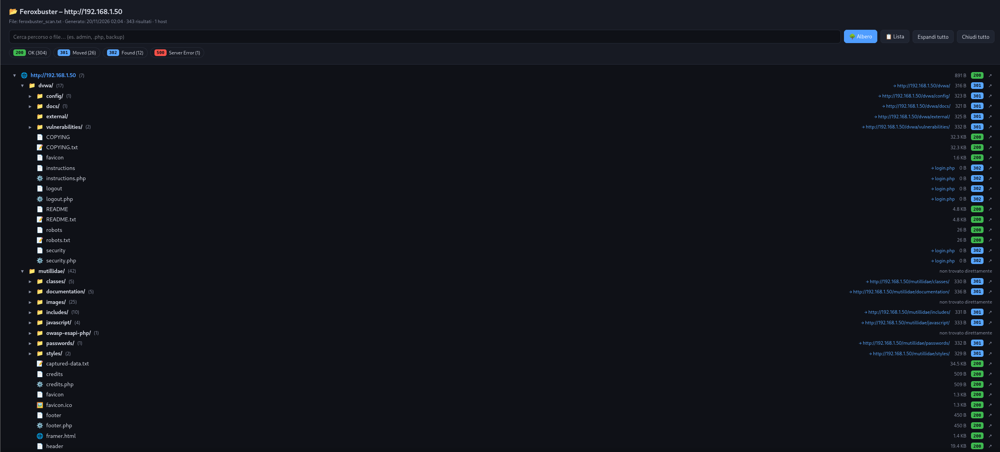

<div align="center">

# 🌳 Ferox2html — FeroxbusterTree

**Turn your feroxbuster scan into a clean, clickable DirBuster-style tree.**


[English](#-what-it-does) · [Italiano](#-italiano)



</div>

---

## ✨ What it does

[feroxbuster](https://github.com/epi052/feroxbuster) is fast, but its output is a long flat list of URLs.
**Ferox2html** reads the output file and builds a single, self-contained HTML page where you can browse every folder and file the scan found, just like the old DirBuster tree.

- 🌳 **Tree view**: folders and files grouped by host, expand/collapse with one click
- 📋 **List view**: a sortable table (status, size, lines, words, URL)
- 🎨 **Coloured status codes**: 2xx green · 3xx blue · 4xx orange · 5xx red
- 🔀 **Redirects**: see where each 301/302 points
- 🔍 **Instant search**: type `admin`, `.php`, `backup`…
- 🎛️ **Status filters**: click a badge to hide or show 403s, 301s and so on
- 📋 **Copy URL** in one click, ↗ **open** it in a new tab
- 🧩 **File-type icons**: scripts, backups, configs, images…
- 📦 **Zero dependencies**: plain Python 3, and the report is one offline HTML file
- 🛡️ **Safe rendering**: names coming from the target are shown as plain text, never executed

## 📸 Screenshots


*Run it with no arguments and pick the file from a window:*


> Screenshots taken against **Metasploitable 2**, a deliberately vulnerable lab VM.

## 🚀 Quick start

```bash
git clone https://github.com/SangueFreddo/Ferox2html-FeroxbusterTree.git
cd Ferox2html-FeroxbusterTree
```

**1. Run feroxbuster and save the output**

Recommended scan (used for the screenshots):

```bash
feroxbuster --url http://<TARGET_IP> \
  -w /usr/share/wordlists/dirbuster/directory-list-2.3-medium.txt \
  -x php,txt,html -d 3 -t 50 \
  --filter-status 404,403 \
  -o ~/Desktop/feroxbuster_scan.txt
```

| Option | Meaning |
|---|---|
| `-w` | wordlist (DirBuster medium, preinstalled on Kali) |
| `-x php,txt,html` | also try these extensions |
| `-d 3` | recursion depth: up to 3 folders deep |
| `-t 50` | 50 threads |
| `--filter-status 404,403` | hide "not found" and "forbidden" results |
| `-o` | save the results to a file |

Minimal version, and JSON output (also supported):

```bash
feroxbuster -u http://<TARGET_IP> -o scan.txt
feroxbuster -u http://<TARGET_IP> --json -o scan.json
```

**2. Convert it**

```bash
python3 ferox2html.py ~/Desktop/feroxbuster_scan.txt
```

That's it: `feroxbuster_scan.html` is created next to your scan and opens in your browser.

### Other ways to run it

| How | Command |
|---|---|
| Choose the output name | `python3 ferox2html.py scan.txt -o report.html` |
| Don't open the browser | `python3 ferox2html.py scan.txt --no-open` |
| Pick the file from a window | `python3 ferox2html.py` (no arguments) |
| Windows drag & drop | drag `scan.txt` onto `ferox2html.py` |

Try it right away with the included example:

```bash
python3 ferox2html.py example/example_scan.txt
```

## 🖱️ Using the report

| Action | How |
|---|---|
| Expand / collapse a folder | click the folder name or the ▸ arrow |
| Expand / collapse everything | **Espandi tutto** / **Chiudi tutto** |
| Copy a URL | 📋 button (or double-click the name) |
| Open a URL | ↗ button |
| Filter by status | click the status badges at the top |
| Search | type in the search bar |
| Sort the table | **Lista** view, click a column header |

## 📄 Supported input

| feroxbuster option | Format | Supported |
|---|---|:---:|
| `-o file` | plain text | ✅ |
| `--json -o file` | JSON lines | ✅ |
| Lines with redirects (`=>`) | text | ✅ |
| Colour codes (ANSI) | text | ✅ stripped automatically |
| Multiple hosts in one file | both | ✅ one tree per host |

Lines that are not results (wildcard notices, errors, statistics) are skipped.

## ⚙️ Requirements

- Python **3.7+**
- Nothing else: only the standard library is used

## ⚠️ Disclaimer

This tool only reads files you already have; it sends no traffic.
Run feroxbuster **only against systems you own or are explicitly authorised to test**.

## 📜 License

[MIT](LICENSE) © [SangueFreddo](https://github.com/SangueFreddo)

---

## 🇮🇹 Italiano

**Ferox2html** trasforma l'output di feroxbuster in una pagina HTML con l'albero di cartelle e file, come DirBuster.

Scansione consigliata:

```bash
feroxbuster --url http://<IP_TARGET> -w /usr/share/wordlists/dirbuster/directory-list-2.3-medium.txt -x php,txt,html -d 3 -t 50 --filter-status 404,403 -o ~/Desktop/feroxbuster_scan.txt
python3 ferox2html.py ~/Desktop/feroxbuster_scan.txt
```

Si crea `feroxbuster_scan.html` e si apre nel browser. Puoi anche trascinare il file sopra lo script (Windows) o avviarlo senza argomenti per scegliere il file da una finestra.

Nella pagina trovi: **albero** con cartelle apribili, **lista** ordinabile, **status code colorati**, redirect, **ricerca**, **filtri per status**, tasto 📋 per **copiare il link** e ↗ per **aprirlo**.

Nessuna libreria da installare: basta Python 3.7 o superiore.
Usalo solo su sistemi tuoi o per cui hai l'autorizzazione.
